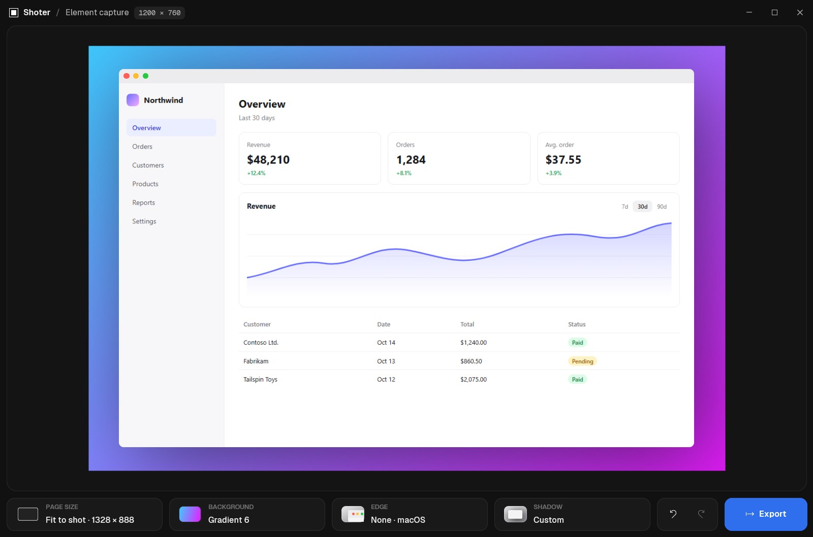
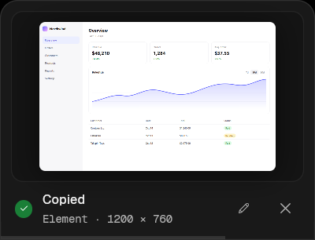
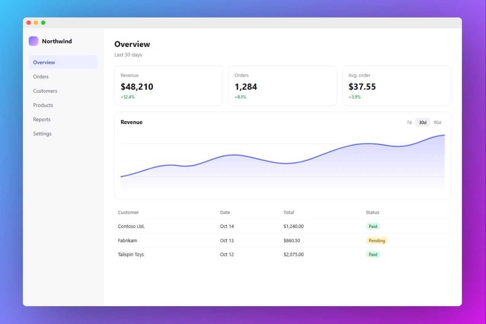

<p align="center"></p>

# Shoter

Element-aware screenshots for Windows.

Website: https://erfjab.github.io/Shoter/

- Press `PrtSc`, point at a button, a dialog, a table or a window, and click: Shoter captures
  exactly that element. Drag instead to grab any region.
- The capture is copied right away, and a small thumbnail slides into the corner.
- One click opens the editor: gradient backdrops, window headers, strokes, rounded corners,
  shadows and ready-made sizes for every social network. Then copy or save as PNG.
- Runs in the background and uses no CPU while idle.

<p align="center"></p>

| Copied at once | Ready to post |
|---|---|
|  |  |

## Install

In PowerShell:

```powershell
irm https://raw.githubusercontent.com/erfjab/Shoter/master/install.ps1 | iex
```

The same command installs Shoter the first time and updates it later. It only replaces the
program; your saved shots are never touched. If the download fails, the installed version is
left as it was. Shoter is added to the Start menu and starts with Windows.

## Build from source

### Requirements

- Windows 10 or 11
- [Rust](https://rustup.rs) with the MSVC toolchain
- Windows 10/11 SDK (install it with the Visual Studio Build Tools)

If the build can't find `fxc.exe` (older SDKs), point it at the SDK's copy:

```powershell
$env:GPUI_FXC_PATH = "C:\Program Files (x86)\Windows Kits\10\bin\10.0.22621.0\x64\fxc.exe"
```

### Build and install

Open PowerShell in the project folder and run:

```powershell
cargo build --release
taskkill /im shoter.exe /f 2>$null
mkdir "$env:LOCALAPPDATA\Programs\Shoter" -Force
copy target\release\shoter.exe "$env:LOCALAPPDATA\Programs\Shoter\"
& "$env:LOCALAPPDATA\Programs\Shoter\shoter.exe"
```

The first build takes a few minutes.

## Update

Pull or edit the code, then run the same commands as in Install.

## Uninstall

1. Right-click the Shoter tray icon and choose **Quit Shoter**.
2. Delete `%LOCALAPPDATA%\Programs\Shoter`.
3. Delete `Shoter.lnk` from the Start menu folder (`%APPDATA%\Microsoft\Windows\Start Menu\Programs`)
   and from the Startup folder (`shell:startup`).
4. Your shots stay in `Pictures\Shoter`; delete that folder too if you don't need them.

## Use

Press `PrtSc`. The screen freezes and the element under the mouse is highlighted.

| Key | Action |
|---|---|
| click | capture the highlighted element |
| drag | capture a region |
| scroll | step out to the parent element, or back in |
| `Esc` | cancel |

The capture goes to the clipboard at once. The thumbnail in the corner stays for five seconds
(hovering keeps it); click **Edit** to open the editor.

### Editor

Everything is in one row under the preview; each button opens its panel.

| Panel | What it does |
|---|---|
| Page size | exact width and height, scale, position pad, sizes for Instagram, TikTok, X, YouTube, LinkedIn, Facebook, Pinterest, web and print |
| Background | 50 gradients, blur (melts the gradient into a soft mesh) and grain |
| Edge | corner radius, stroke and window header (macOS, Windows, browser) |
| Shadow | direction pad, size, blur, opacity and presets |
| Export | copy to the clipboard or save as PNG to `Pictures\Shoter` |

| Key | Action |
|---|---|
| `Ctrl+Z` / `Ctrl+Y` | undo / redo |
| `Esc` | close the open panel |
| double-click a pad | reset it |

Edge and shadow never resize the page or the shot; they are drawn around it.

## Why it is light

- Idle, Shoter is one hidden window and a thread that waits for `PrtSc`. No timers, no polling.
- Elements are found with UI Automation, fetched once per capture, plus a pixel pass that finds
  frames UI Automation misses (editors, canvases, custom-drawn apps).
- Backdrops are drawn by code, not stored as images. Every image is freed when its window closes,
  and memory is handed back to Windows after each capture.
- Export runs on a background thread. No network.

## Develop

```powershell
cargo run          # debug build
cargo test         # unit tests
.\run.bat          # stop the running copy, build, and start the new one
```

Set `SHOTER_EDITOR=1` before starting to open the editor on a test image without capturing
the screen. Only one Shoter runs at a time; a second copy exits right away.

| File | Purpose |
|---|---|
| `src/main.rs` | startup, single instance, app state |
| `src/win/` | Windows parts: keyboard hook and tray, screen capture, UI Automation, clipboard |
| `src/vision.rs` | pixel frame detection |
| `src/overlay.rs` | capture overlay and element highlight |
| `src/toast.rs` | corner thumbnail |
| `src/editor.rs` | editor window and panels |
| `src/compose.rs` | export compositing (the preview uses the same numbers) |
| `site/` | website, published to GitHub Pages |
| `assets/` | logo (`logo.svg`), the app icon embedded in `shoter.exe`, Geist fonts (SIL Open Font License) |
